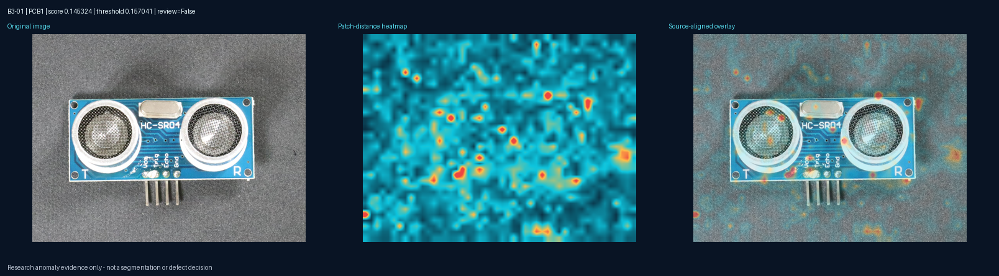
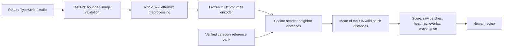

<div align="center">

# ForgeSight AI

### Industrial PCB inspection, with evidence you can inspect

DINOv2 visual anomaly research · React inspection studio · FastAPI CPU inference

[](https://github.com/ksuyamburaj07/ForgeSight-AI/actions/workflows/python-ci.yml)
[](https://github.com/ksuyamburaj07/ForgeSight-AI/actions/workflows/frontend-ci.yml)
[](LICENSE)

**[Open the live application ↗](https://forgesight-ai-6d5yatbeia-el.a.run.app/)** · [Installation](#installation) · [Research & limits](#research-and-scientific-limits) · [Runtime provenance](docs/engineering/RELEASE_CPU_RUNTIME.md)

</div>

ForgeSight AI is an independent computer-vision research and engineering project for human-supervised inspection of printed circuit boards. It connects frozen feature representations and category-specific reference banks to an application that exposes scores, raw patch distances, source-aligned heatmaps, overlays, and research provenance.

**Live on Google Cloud Run.** Genuine DINOv2-Small CPU inference has been exercised for **PCB1–PCB4**. The owner also completed browser acceptance. The hosted four-category checks used synthetic inputs: they establish that inference executes, not real-world defect-detection accuracy. [Deployment record](docs/engineering/PUBLIC_DEPLOYMENT.md)

> **Research prototype; human review required.** The 802-case evaluation is retrospective and non-independent. Strict cross-platform numerical reproduction passed **3 of 4 audited cases**; all four review flags agreed. The remaining numerical gate stays open. ForgeSight is not a certified manufacturing inspection system.

## What the application offers

- **Inspection studio:** image upload, browser camera capture, and paced serial video-frame sampling.
- **Linked evidence:** original image, patch-distance heatmap, overlay, and interactive 2D/3D views. The surface represents relative model distances, not physical PCB height.
- **Research explorers:** six historical model configurations, dataset inventory, 16 attributed normal-training photographs, and a four-case historical atlas.
- **Traceable inference:** validated image decoding, source SHA-256, verified encoder/bank identities, frozen category thresholds, and explicit review indicators.
- **Software evidence:** **225 self-contained Python CI tests** and **68 frontend CI tests**. Six historical evidence tests were verified separately in the configured local research environment; they require excluded research files.

### Historical evidence preview



*A selected retrospective diagnostic, not a screenshot of a new live inspection. VisA image material © Amazon.com, Inc. or its affiliates, CC BY 4.0; ForgeSight heatmap/overlay modifications. [Attribution and interpretation](frontend/public/research-atlas/ATTRIBUTION.md). A low score or a bright region does not confirm the presence or absence of a physical defect.*

## Architecture



The encoder produces a **48 × 48 patch grid with 384-dimensional features**. Each category bank was constructed from **eight normal reference images**. Interpolation and smoothing affect visualization, not the frozen raw image score. No foreground-only scoring modification has been approved for deployment.

The FastAPI endpoint serializes inference within one process and validates file type, decoded dimensions, and upload size. The current hosted application uses a separate private Cloud Run build context containing authorized runtime assets. The Nginx/systemd files here describe an earlier VPS option; they are not the active cloud configuration.

## Installation

Use **Python 3.12**, **Node.js 24**, and npm. Linux CPU source installation is exercised by GitHub Actions. The public source supports development and self-contained software testing; **weights and frozen banks are not distributed in GitHub or GitHub Packages**.

```bash
git clone https://github.com/ksuyamburaj07/ForgeSight-AI.git
cd ForgeSight-AI
python3.12 -m venv .venv
source .venv/bin/activate
python -m pip install --upgrade pip

# Install the verified CPU wheels before the project extras.
python -m pip install --index-url https://download.pytorch.org/whl/cpu \
  'torch==2.15.0+cpu' 'torchvision==0.29.2+cpu'
python -m pip install -e '.[dev,service,inference,research]'
python -m pip check
python -m pytest -q --ignore=tests/test_m312b3_evidence_review.py

cd frontend
npm ci
npm test
npm run build
```

The six excluded tests need the original ignored reviewer worksheet and evidence summary. They are not part of the 225-test fresh-checkout claim. [Test and evidence policy](docs/engineering/CLEAN_CHECKOUT_TEST_POLICY.md)

For the lightweight **image-validation CLI** alone, install `python -m pip install -e .`, then run `forgesight inspect /absolute/path/to/image.png`. Its `inference_performed: false` field is intentional; neural inference belongs to the API.

### Run the inspection studio locally

First provision the **exact authorized encoder snapshot, metadata, and four frozen banks** following the [CPU runtime guide](docs/engineering/RELEASE_CPU_RUNTIME.md). The loader verifies their hashes. There is no public download location for the original banks, so a fresh clone alone cannot run genuine inference. Do not rebuild substitute banks from the public gallery.

From the repository root, in the activated Python environment:

```bash
uvicorn forgesight.api.app:app --host 127.0.0.1 --port 8000 --workers 1
```

In another terminal:

```bash
cd frontend
npm ci
npm run dev
```

Open `http://127.0.0.1:5173`. Vite proxies `/api` to the local service. Local readiness is `/api/v1/ready`; the hosted public application intentionally returns 404 for that route.

| Endpoint | Purpose |
|---|---|
| `GET /api/v1/health` | Process liveness and scientific gate status |
| `GET /api/v1/capabilities` | Categories, input limits, evidence contract |
| `POST /api/v1/inspect` | Multipart `category` and `file`; genuine CPU inference |
| `GET /api/v1/ready` | Local artifact verification; hidden on the public deployment |

The API returns `inspection`, `patch_evidence`, and `visualizations`. A flagged score requests human review; it is not a manufacturing rejection decision.

The `research` extra supports the source CI and current scientific utilities. Some historical ResNet/plotting scripts additionally require `timm` or `matplotlib` and their original external inputs; the source CI does not reproduce every historical experiment. See the [runtime scope](docs/engineering/RELEASE_CPU_RUNTIME.md).

## Research and scientific limits

The project progressed from dataset and split audits through representation comparisons, threshold analysis, spatial failure investigations, artifact verification, and an interactive application. It evaluated **six historical configurations**, with useful tradeoffs rather than a universal winning model.

| Historical configuration | Macro image AUROC | Anomalies flagged / 400 | Normal images flagged / 402 |
|---|---:|---:|---:|
| DINOv2 full-frame | 0.8001 | 114 | 24 |
| DINOv2 tiled | **0.9018** | 185 | 15 |
| ResNet coreset / PatchCore-style | 0.8253 | 152 | 20 |
| PaDiM-style | 0.8053 | 160 | 34 |
| Student–teacher / STFPM-lite | 0.7664 | 139 | 27 |
| DINOv2-Small, 672 px — active workflow | 0.8927 | **255** | 59 |

These are **802 reused VisA cases: 400 anomaly-labelled and 402 normal-labelled images**. AUROC describes ranking; the counts use each configuration's own frozen category thresholds. They are not comparisons at a common false-review rate. The active 672-pixel configuration flagged more anomalies than tiled DINOv2 at its own thresholds, with more normal images also flagged.

For the active frozen experiment: **TP 255 · FN 145 · FP 59 · TN 343**. These results do not establish independent external validation, factory accuracy, or generalization to new cameras and boards.

- **Numerical reproduction:** 3/4 selected cases met absolute tolerance `0.00005`; 4/4 review flags were unchanged. [Exact scores and open gate](docs/engineering/M314B_CPU_REPRODUCTION_NOTE.md)
- **Spatial diagnostics:** four purposively selected retrospective cases exposed background-associated evidence and boundary sensitivity. They do not prove causation or population-level improvement.
- **Visualization:** interpolated patch evidence is not pixel-level defect segmentation; 3D views are not physical metrology.
- **Domain shift:** camera and video inputs can differ substantially from VisA. A model score is not a physical diagnosis.
- **Frozen method:** thresholds, bank bytes, weights, preprocessing, and acceptance criteria remain unchanged by this public release. [Artifact registry](docs/engineering/FROZEN_M312A_ARTIFACT_REGISTRY.md)

Public aggregates are in [model-registry.json](frontend/public/benchmark/model-registry.json) and [paired-outcomes.json](frontend/public/benchmark/paired-outcomes.json). Their source references identify historical research records; they do not distribute all original records or independently reproduce them.

## Repository and artifact boundaries

| Path | Contents |
|---|---|
| `src/forgesight/` | Validation CLI, scientific modules, frozen inference engine, FastAPI |
| `frontend/` | React studio, tests, curated public research assets |
| `tests/` | Source regressions and separately scoped historical evidence tests |
| `scripts/`, `splits/` | Research utilities and source-path/label/hash protocols |
| `docs/` | Engineering, provenance, scientific and release records |
| `deployment/` | Historical VPS templates |

**Kept outside Git:** original VisA data/masks/archives, pretrained model binaries, frozen reference banks and metadata reports, reviewer worksheets, private research reports/notebooks, and the artifact-bearing cloud build context.

**Intentionally public:** code, split metadata, selected aggregate results, four curated atlas triptychs and patch fields, 16 gallery photographs, and a compressed 24-case selection metadata manifest in a historical script. These are documented public derivatives, not the full frozen dataset or private report collection. [Public-release audit](docs/engineering/PUBLIC_RELEASE_AUDIT.md)

## Licensing, attribution and contributions

Original ForgeSight code is [MIT licensed](LICENSE). **MIT does not relicense third-party data or models.** The 16 normal-training VisA gallery images and four VisA-derived atlas triptychs retain **CC BY 4.0** attribution and modification notices. Upstream DINOv2-Small is identified as **Apache 2.0**; its binaries are obtained separately. Dependencies retain their respective licenses. [Third-party notices](THIRD_PARTY_NOTICES.md)

VisA: Yang Zou, Jongheon Jeong, Latha Pemula, Dongqing Zhang and Onkar Dabeer, *SPot-the-Difference Self-Supervised Pre-training for Anomaly Detection and Segmentation* (2022). [Dataset publisher](https://github.com/amazon-science/spot-diff) · [AWS dataset/license record](https://registry.opendata.aws/visa/) · [DINOv2 model card](https://huggingface.co/facebook/dinov2-small)

Built by [Suyambu Raj Kanagaraj](https://github.com/ksuyamburaj07). Contributions should preserve scientific provenance and explicit limits. [Contributing](CONTRIBUTING.md) · [Security reporting](SECURITY.md) · [Repository guide](docs/REPOSITORY_GUIDE.md)

Historical milestone READMEs and M0 records are retained as dated research records; the current runtime and release guides supersede their deployment status.
